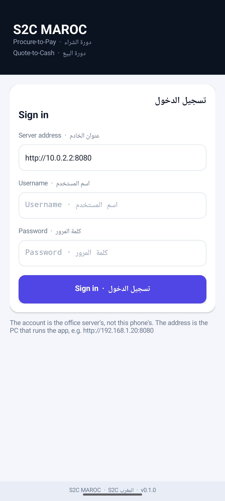
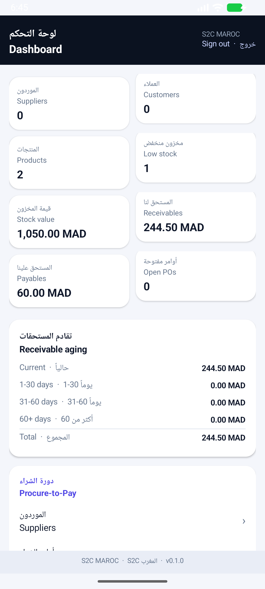
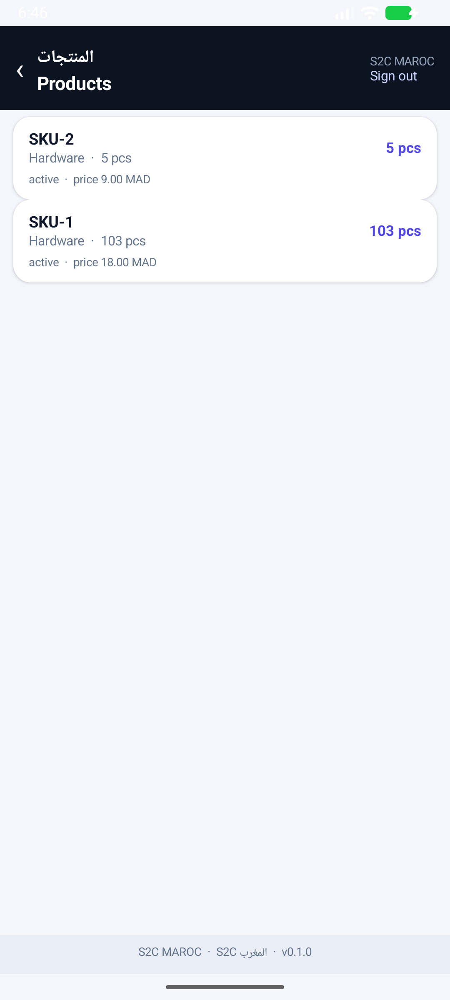

# S2C MAROC — Android client

The phone app for the shop's ledger. It **stands alone**: a fresh install opens on its
own SQLite database, with no server and no network, and the shop is run from the phone —
a till, plus products, suppliers, customers and the credit book. The office server is the
second option, not a requirement — switching to it reads the same `/api/v1` this project
serves (documented in [`../docs/API.md`](../docs/API.md)).

Current version: **0.3.0** (`versionCode` 5). The client version moves on its own, apart
from the web app's.

The app opens on a **sign-in page** that carries the settings link and the version; local
mode asks for nothing and its button simply opens the till. Under the till there is a tab
strip: **Cashier · Products · Suppliers · Customers · Credit**.

| Sign in (server mode) | Dashboard | A list |
| --- | --- | --- |
|  |  |  |

The screenshots are from 0.1.2 and show server mode; 0.3.0 replaced the dashboard with the
cashier below, and every tab reads the phone's own rows in local mode.

## What works today

| Screen | What it shows |
| --- | --- |
| **Sign in** | Company, version and a settings link; server mode adds address, username and password |
| **Cashier** | The till: search the phone's products, tap one to add it, then *Review cart* → quantity, payment (cash or credit) and **Charge** |
| **Products / Suppliers / Customers** | The phone's own lists, **+ Add** on each, long press to delete behind a confirmation |
| **Credit** | One row per customer with an unpaid credit sale: what they owe, their phone and limit. A long press settles the whole debt |
| **Settings** | Database: **Local — this phone** or **Server — IP address**, the company name and the currency |

A sale is written in one transaction: the `sales` and `sale_items` rows, then the
quantities come out of stock, so a cart that asks for more than the shelf holds is refused
with the quantity that is left. Cash sales are paid immediately; a credit sale stays in
the **Credit** tab until it is settled, and settling marks those sales paid.

In local mode a list is a working screen: **+ Add** opens a form (name, code/SKU, phone,
city, price, cost, stock, reorder level) and a long press on a row offers *Delete*, behind
a confirmation. Records live in the phone's own `s2c.db`.

## Where the settings live

The database choice, server address, company name and currency are kept in a plain text
file, not compiled in, so they can be changed after install — from **Settings** in the app,
or from a computer:

```
Android/data/ma.s2c.maroc/files/s2c.properties

db.mode=local                     # local | server
server.url=http://10.0.2.2:8080
company.name=S2C MAROC
company.currency=MAD
```

The file is written on the first run and survives updates; uninstalling the app removes
it, which also removes the database. **Delete the app's data to start a clean ledger.**

`db.mode=local` uses `s2c.db` on the phone. `db.mode=server` reads the office computer
after signing in; the token is kept in `SharedPreferences`, never in the file.

## Fonts

The app sets its text in the same two faces as the web UI: **Comfortaa** for Latin and
numbers, **VIP Rawy** for Arabic, each with a regular and a bold cut. A phone cannot pick
a font by script the way a CSS font stack does, so every label is cut into runs of Arabic
and non-Arabic characters and each run is given its own face — that is what keeps
`Delete  ·  حذف` reading like the browser, with the Arabic in Rawy and the Latin in
Comfortaa.

The files live in `app/src/main/assets/fonts/` and are read once per process
(`Ui.font`); an input field takes Comfortaa alone, because spans do not survive typing, and
Arabic typed there falls back to the system face.

Comfortaa is SIL Open Font License (see `../static/fonts/OFL-Comfortaa.txt`). **VIP Rawy is
a commercial face and is not committed** — same rule as the web app: copy
`VIP-Rawy-Regular.ttf` and `VIP-Rawy-Bold.ttf` into `app/src/main/assets/fonts/` before
building for a shop that needs the Arabic branding. Without them the app still runs, in the
system font.

## Build

From the repository root:

```bash
bash tools/build_android.sh                    # → android/dist/s2c-maroc-0.3.0-debug.apk
bash tools/build_android.sh assembleRelease    # → android/dist/s2c-maroc-0.3.0-release.apk
```

The debug APK carries the `android:debuggable` flag and is what `adb install` expects;
the release APK is the same code without it, for handing over as a file. Both are signed
with the debug key, as noted under *Install*.

The script uses the JDK bundled with Android Studio (`C:/Program Files/Android/Android
Studio/jbr`) because a machine whose `PATH` finds a JRE 1.8 cannot compile. Override it
with `S2C_JAVA_HOME=/path/to/jdk` if the SDK lives elsewhere.

Building directly:

```bash
export JAVA_HOME="C:/Program Files/Android/Android Studio/jbr"
gradle -p android assembleDebug      # org.gradle.java.home is also pinned in android/gradle.properties
```

`android/local.properties` points at the SDK (`sdk.dir`); it is machine-local and
git-ignored, as is `android/dist/`.

## Install

```bash
adb install -r android/dist/s2c-maroc-0.3.0-debug.apk
```

Or copy the APK to the phone and open it (allow "install unknown apps" for the file
manager). The APK is signed with the debug key: it is meant for the phone on your desk,
not for a store.

## Point it at your server

Server mode is chosen in **Settings**; the address is remembered.

- **Emulator**: `http://10.0.2.2:8080` (the default) is the host machine's loopback.
- **Phone on the same Wi-Fi**: the PC's LAN address, e.g. `http://192.168.1.20:8080`.
  The server already binds `0.0.0.0`, so nothing needs changing on the PC; if the
  connection is refused, check Windows Firewall allows port 8080 on the private network.

Cleartext HTTP is allowed deliberately (`android:usesCleartextTraffic="true"`), because
an office server on the LAN has no certificate. Put the server behind TLS before the app
leaves a trusted network.

## Layout

```
android/
  settings.gradle.kts, build.gradle.kts, gradle.properties
  app/build.gradle.kts                  compileSdk 35, minSdk 24, versionName 0.3.0
  app/src/main/AndroidManifest.xml      INTERNET, cleartext, one activity
  app/src/main/res/                     theme, strings, adaptive launcher icon
  app/src/main/java/ma/s2c/maroc/
    MainActivity.java                   screens: sign in, cashier, cart, tabs, lists, record form, settings
    LocalDb.java                        the phone's SQLite database (suppliers, customers, products, sales, credit)
    Ui.java                             colours, cards, bilingual labels, the two typefaces
    Config.java                         s2c.properties: db.mode, server.url, company, currency
    Api.java                            HttpURLConnection + org.json, token in SharedPreferences
    Ui.java                             palette and view factories (Arabic above Latin)
```

Screens are built in Java rather than XML layouts because every label here is bilingual
and stacked — Arabic above the Latin — and that rule is easier to keep in one place than
across a pile of layout files.

## Not built yet

In the order they would matter on a shop floor:

1. **Documents on the phone**: a purchase order, invoice or ticket screen. The local
   database holds master data only, so those flows stay in the web app — and the API for
   them is `GET` only today.
2. **Sales at the counter**: a local cart that writes a ticket and moves stock.
3. **Bluetooth receipts**: the browser already prints ESC/POS over Web Bluetooth; the
   native equivalent is `BluetoothLeScanner` + the same byte stream from
   `src/ticket.rs`.
4. **Sync**: local and server are two datasets, with no merge between them.
5. **Backup/restore** of `s2c.db`, and release signing with a key that belongs to the
   owner.
